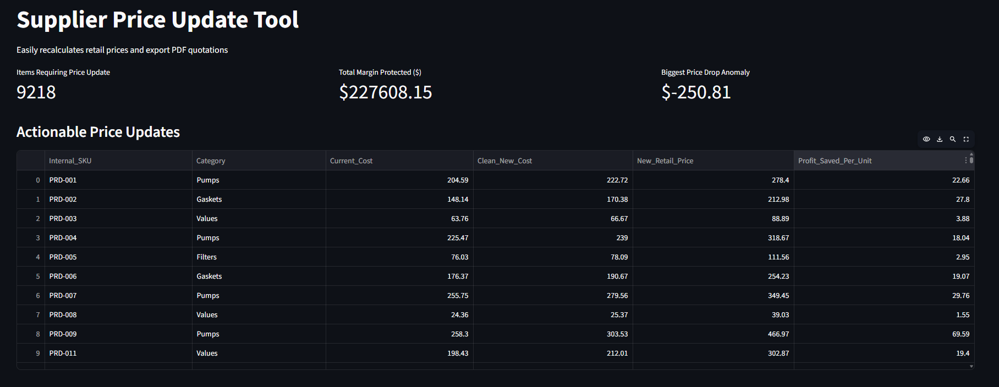
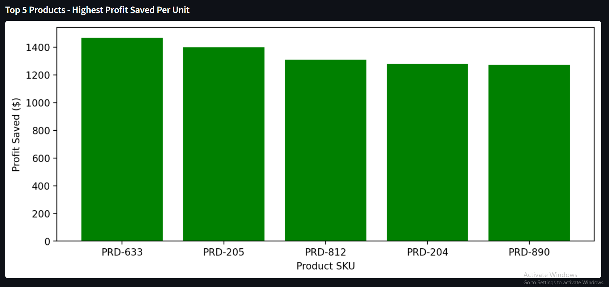
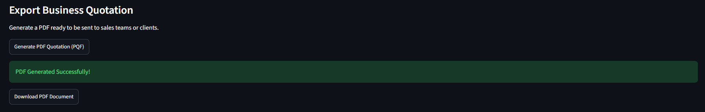

### Supplier-Pricing-Tool

I built this project over the course of about a month during my 4th year at UPB. I wanted to explore the financial space too. I started to brainstorm some project ideas and I eventually found one that caught my attention. Whenever a store or a B2B distributor works with multiple suppliers, they constantly receive updated price lists. The issue? These lists are usually massive, messy CSV or Excel files. If a supplier quietly raises the price of something by 15% and the store doesn't immediately update its own retail price, the store's profit margin is gone.

Doing this manually across thousands of items is a nightmare. I realized that writing a script to automate this comparison could literally save a good amount of money in a matter of seconds.

So, how does this Pythin project work? It ingests messy supplier data, matches it against an internal inventory and automatically calculates the new retail prices required to protect profit margins.

### The math behind it

To make sure the business doesn't lose money when a supplier gets more expensive, the script recalculates everything using a standard commercial pricing formula:

<B> New Retail Price = New Supplier Cost / (1 - Target Margin) </B>

It calculates the difference between the old and new costs, flags any weird anomalies (like a supplier typo that drops a price by 10x), and computes exactly how much profit is saved per unit by running the update.

### Project MVPs

Instead of just a terminal script, I wanted to build a complete, usable tool. The main highlights are:

* Handles typical human errors found in real-world supplier files (like extra spaces in product codes, random currency symbols ($), european commas, instead of dots, missing values, etc.
* Filters out all the noise and isolates only the products that actually need a retail price update
* Clean and interactive interface where you can see the anomalies, the updated prices and the total margin protected
* A one-click export that takes the updated data and generates a clean PDF quotation

### Built With

-> Python (Pandas & NumPy for data cleaning and math)
-> Streamlit (web interface)
-> FPDF (generating PDF files)
-> Matplotlib (visual charts)

### A quick glimpse at how the app looks like

I wanted the interface to be as straightforward as possible. Here is a look at the main web app and the data table:

I also added a quick visual chart to highlight the biggest wins. It shows the top 5 products where updating the retail price saved the most profit per unit.

And here is the export section at the bottom, where the user can generate the updated price list with a single click

You can also check the resulted PDF file: **[here](images/Price_Quotation.pdf)**
